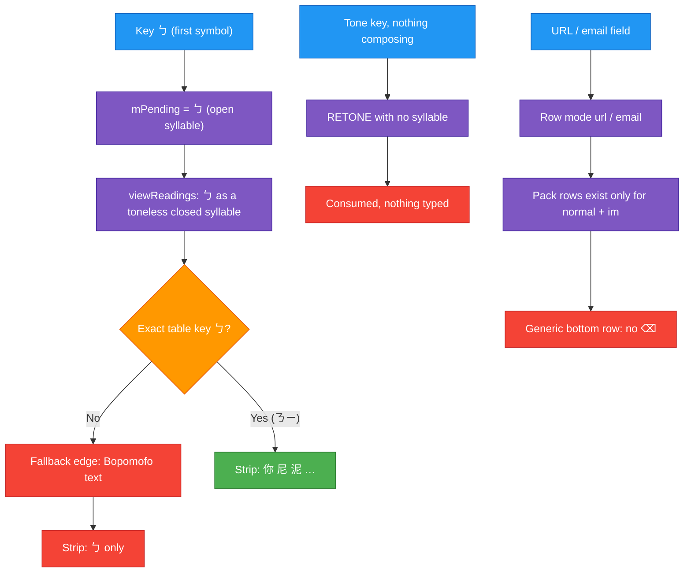
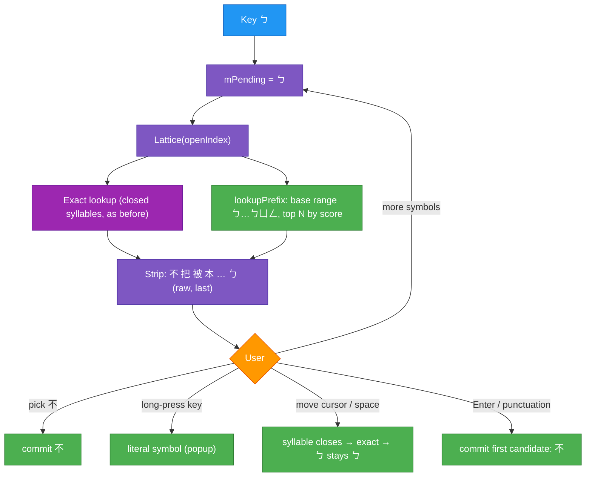

# TASK-002: Zhuyin: compact height, suggestions from the first symbol, literal symbols, URL row
Created using task template in docs/tasks/task_template.md

Follow-up to [TASK-001](task_001_zhuyin_smart_input.md) (engine design, dev-machine and on-device rules live there).

## Full initial request (verbatim)

> See zhuyin-compact-patches, after reading docs/tasks/task_template.md Please apply the patches for symbol height. Then work on these things: Make it show suggestions from the first typed symbol, proper freqs and shit, also allow to type standalone characters by either moving the cursor OR long pressing the character. Also bug: In URLs the delete key disappears, fix. Maybe rethink if we should be able to type urls in zhuyin or should revert. Also allow to type standalone tone characters, for some reason now it is impossible. Go, gl hf.

## Overview

Five things on top of the TASK-001 Zhuyin keyboard:

1. Apply `zhuyin-compact-patches.zip` (compact key height: four Bopomofo rows as tall as three QWERTY rows).
2. Candidates from the first typed symbol (a lone ㄅ already offers 不 把 被 …), ranked by frequency.
3. A way to type a Bopomofo symbol itself, now that a lone symbol offers Hanzi: by moving the cursor, or by long-pressing the key.
4. Bug: in URL fields the ⌫ key is missing. Decide whether Zhuyin should stay active in URL fields.
5. Bug: a tone mark (ˊ ˇ ˋ ˙) cannot be typed on its own.

## User decisions (precise wording)

| Topic | Decision (user's words) |
|---|---|
| Patches | "Please **apply the patches for symbol height**." → all three patches of the zip applied (see *Patches*) |
| Prefix suggestions | "Make it **show suggestions from the first typed symbol**, **proper freqs** and shit" |
| Literal symbols | "also allow to **type standalone characters by either moving the cursor OR long pressing the character**" → read as: standalone *Bopomofo* symbols (my interpretation; the next item about tones supports it) |
| URL fields | "Also bug: **In URLs the delete key disappears, fix.** Maybe **rethink if we should be able to type urls in zhuyin or should revert**." → decision left to me, see *URL fields* |
| Tones | "Also allow to **type standalone tone characters**, for some reason now it is impossible." |
| Process | "Go, gl hf." → no stop for a solution pick; "**Create task file pls**" → this file |
| One dev build | "**side by side compact may go, we should go back to one dev build.** I connected my phone, **put the new build on it, copy compact settings to it** when done. YOu can make scrs and test on my phone rn" → patch 0002 (`sideBySide` build type) reverted; `.zhuyindev` rebuilt and installed; Compact's prefs + learned picks copied into it; it is the default keyboard. The `.sidebyside` app is still installed (removal awaits a yes) |
| Phone awake | "Phone may sleep soon, **disable sleep now for a bit**" → `svc power stayon true` during testing, original value (0) restored after |
| Panel / strip | "Also **pressing the down key to open symbol suggestions and back up makes suggestions disappear**. Also the **down icon placement is bullshit**. And **why do we have the turkey emoji there** lol?" → disappearing strip fixed (2.7); ▼ placement parked for a pick (2.8, see *▼ placement options*); the turkey is ASK's own seasonal Thanksgiving strip icon (`saywhat/ThanksgivingNotice`), not part of this work |

| ▼ placement | Picked "**Far right, alone (Recommended)**" → ▼ is the only strip action while Zhuyin candidates show, at the strip's end, as tall as the strip |
| Compact app | Picked "**Uninstall it**" → `com.menny.android.anysoftkeyboard.sidebyside` removed from the phone (data backup in `scratch/phone_backup/20261121/`) |
| Cursor | "Also, **arrow keys should allow to go inbetween bpmf chars, not skip all over them** pls" → the cursor moves symbol by symbol (2.10) |
| More testing | "Make phone not sleep again, **do more tests and cases.**" → see *On-device cases* |

## Design principles
- **No backwards compatibility** - Clean implementation, update all code in place
- KISS
- Elegant
- No new 3rd-party dependencies without explicit user approval
- Engine stays pure JVM (TASK-001), so everything in `ime/phonetic` is tested without Android

---

## Current analysis

### Patches

| Patch | What it does | Status |
|---|---|---|
| 0001 compact key height | New height code `-4` (`key_compact_height`): 4 rows = 3 normal rows, incl. row gap and the user's height factor. 4-row Zhuyin layouts use it; Hsu / ETen26 (3 rows) use normal height. Test `KeyboardSupportHeightTest` | ✅ applied |
| 0002 `sideBySide` build type | Debug build with `applicationIdSuffix .sidebyside`, label "AnySoftKeyboard Compact". Overlaps with `.github/zhuyindev.init.gradle` | ↩️ applied, then reverted on the user's word ("side by side compact may go") |
| 0003 skip add-ons of other keyboards | With two ASK builds installed, each saw the other's bundled English pack as duplicates. Packages that are input methods are skipped | ✅ applied |

### Current flow (before this task)

Issues:
1. **No candidates until the syllable is a real one.** An open syllable is looked up exactly, so ㄅ, ㄋ, ㄓㄨ (on the way to ㄓㄨㄥ) show only their own Bopomofo.
2. **A lone tone key is swallowed.** `KeyLayout.Standard` answers `RETONE` for a tone with nothing pending; with no closed syllable before the cursor nothing happens, and the key is still reported as used.
3. **⌫ missing in URL / email / password fields.** On the 4-row layouts ⌫ sits in the pack's own bottom row, which is declared only for `keyboard_mode_normal` and `keyboard_mode_im`. In other modes no pack row matches, so ASK adds its generic bottom row, which has no ⌫.
4. **Long-press popups go through the composer.** A popup key reaches `onKey` like a normal key. On the 26-key layouts a long-press "q" is therefore composed as Bopomofo instead of typed.

### Chosen solution implementation details

**Prefix candidates (engine).** Table keys are sorted by (length, syllable bases) and
`base = (initial*4 + medial)*14 + final`, so "every syllable that starts with what was typed" is
one contiguous base range: ㄅ → all ㄅ-syllables, ㄓㄨ → ㄓㄨ + ㄓㄨ*. A span that *ends* at the open
syllable is therefore one contiguous key range, found by binary search.

- `Syllable.maxExtensionBase()`: the end of that range (same base when a final is typed).
- `PhraseTable.lookupExtensions(readings, from, length, open, limit, out)`: all phrases whose last
  syllable extends the open one, best `limit` by score. Extensions get `EXTENSION_PENALTY` (1.5,
  about a factor 4.5 in frequency), so an exact reading wins among similar words (ㄋㄧ → 你 before
  年) while very common longer ones still surface early (ㄓ → 之 只 這 知 中); for an incomplete
  syllable all matches carry the same penalty, so the order is plain frequency
  (ㄅ → 不 本 部 比 表, ㄉ → 的 大 到 得 都). Values 4 / 2.5 / 1.5 were compared on samples.
- `Lattice` gets the index of the open syllable and adds those phrases to the edges ending there.
  The best path uses them too, so the first strip entry predicts (我想ㄑ → 我想去).
- Only the *open* syllable is a prefix. Once closed (space, tone, cursor move) it is exact
  again: a closed lone ㄅ is the symbol ㄅ.
- Picking a candidate that covers the open syllable closes it and pins the phrase (as before).
  Picking the sentence commits the shown path.

**Literal symbols.** One rule: *a key picked from a long-press popup is typed literally* (the
composition is committed first, the popup key never reaches the composer). The Bopomofo keys of
the 41-key layouts get their own symbol added to the popup after the hint (`1ㄅ`, `3ˇ`): long-press
and release still gives the hint (digit / Latin), sliding to the second key gives the symbol.
The same rule fixes long-press Latin letters on the 26-key layouts. Moving the cursor (or space)
closes the open syllable, which then converts to itself.

**Standalone tones.** A tone key with nothing composing is not used by the engine, so the IME
types it as a normal character.

**URL fields.** Zhuyin stays active in URL / email fields: address bars are search boxes, and
`KeyboardSwitcher` already keeps radical keyboards selected there on purpose. The fix is the row:
the pack's bottom row loses its `keyboardMode`, so it is used in every mode (one row instead of
two identical ones per layout).

**Candidates panel.** Closing the panel removed it while the keyboard view was still hidden;
`KeyboardViewContainerView` re-checks on every removed child whether the strip has a visible
keyboard to sit on, found none and hid the strip for good. `closeCandidatesPanel` now shows the
keyboard first.

**Symbol cursor.** The composer's cursor is a syllable position plus a symbol offset into that
syllable. ← / → step one symbol (one character over a picked Hanzi segment; the thin separator
after a toneless syllable is passed together with it). Inside a syllable a typed symbol sets its
slot (ㄋ|ㄧˇ + ㄨ → ㄋㄨˇ), backspace removes the symbol before the cursor, and candidates start at
the syllable the cursor is in. On the 26-key layouts a key typed inside a syllable continues after it.

**Commit = first candidate.** `commitAll` (Enter, punctuation, keyboard switch, field closing)
commits the conversion the strip shows first, so an open syllable is completed (ㄋㄧˇㄏ + Enter →
你會, ㄅ + ， → 不，). A syllable keeps its typed form once it is closed: space (first tone), a tone,
or a cursor move. What the strip highlights is what gets committed.

**App restarts the input.** `onStartInput` with a composition still open means the app changed
its own text (cleared the search box, sent the message). The composition is dropped, not committed:
before, the conversion was typed into the fresh field.

### On-device cases

All on the Xiaomi, dev build, in a Keep share dialog (never saved) and the Google search box.

| Case | Result |
|---|---|
| ㄐㄧㄣㄊㄧㄢㄊㄧㄢㄑㄧˋㄏㄣˇㄏ → pick first | 今天天氣很好 committed, next-word strip follows |
| ㄅ → strip | 不 本 部 比 表 並 被; Enter / ， commit 不 |
| ㄅ, space, Enter | ㄅ (closed syllable stays as typed) |
| ㄋㄧˇㄏㄠˇ， | 你好， |
| ˇ ˋ with nothing composing | typed as text |
| long-press ㄅ | popup `1 ㄅ`; release = 1, slide = literal ㄅ |
| ㄋㄧˇㄏㄠˇㄇㄚ˙, ← ×4, ⌫, ㄠ, Enter | cursor inside ㄏㄠˇ shows 好嗎 好 郝; ⌫ removes ㄠ; retyped; 你好嗎 |
| ㄨㄛㄒㄧㄤㄑㄩ (no tones) | 我想去 first; space makes ㄑㄩ first tone → 我想區 |
| ㄋㄧˇㄏㄠ, switch to Lithuanian | 你好 committed |
| ▼ then ▲ | strip stays |
| search box ✕ while composing ㄏㄠˇ | field empty, nothing re-typed |
| Firefox address bar | ⌫ present on 注音 |

Kept on purpose: space on an open syllable is the first tone (so toneless ㄑㄩ + space is 區, not
去; pick from the strip or press Enter to take the first candidate); a *closed* lone initial is
the literal symbol; a lone tone mark is typed.

### ▼ placement options (picked: A)

Today the strip's action views are laid out right to left over the candidates, in the order they
were added: seasonal icon, ⊗, ▼, dev-build bug. So ▼ lands in the middle, on top of candidate
text, and its opaque background is taller than the strip (it cuts into the top key row).

| Option | Strip while composing |
|---|---|
| A. Far right, alone | `你會 你好 妳會 妳好 …            ▼` (⊗ and the decorative icons hidden while Zhuyin candidates show; candidates stop before ▼) |
| B. Far right, ⊗ kept | `你會 你好 妳會 妳好 …         ⊗ ▼` (decorative icons hidden) |
| C. Far left | `▼ 你會 你好 妳會 妳好 …        ⊗` (candidates start after ▼) |
| D. No button | swipe up on the strip only (already works) |

**Edge cases**
- Open syllable in the middle of the composition (cursor moved back, then typing): prefix
  matching applies to spans ending at it; longer spans across it stay exact.
- 26-key layouts: the open syllable is matched as the layout would finish it (unchanged), plus
  extensions of what was typed.
- A pin over the open syllable keeps the typed reading; undoing the pick shows the typed symbols.
- Popup keys while composing: composition commits first, then the literal character.

**Files to modify**

| File | Change | Status |
|---|---|---|
| patches 0001-0003 | applied with `git apply` | ✅ |
| `ime/phonetic/.../Syllable.java` | `maxExtensionBase()` | ✅ |
| `ime/phonetic/.../PhraseTable.java` | `lookupExtensions` (key run + limit, `EXTENSION_PENALTY = 1.5`), shared `tonePenalty` | ✅ |
| `ime/phonetic/.../Lattice.java` | open-syllable index, extension phrases on edges ending there (`MAX_EXTENSIONS = 64`) | ✅ |
| `ime/phonetic/.../ZhuyinComposer.java` | passes the open syllable, sentence pick commits the shown path, lone tone not consumed | ✅ |
| `ime/app/.../AnySoftKeyboard.java`, `AnySoftKeyboardSuggestions.java`, `Keyboard.java` (`Key.getKeyboard()`) | popup keys bypass the composer; a Bopomofo symbol the composer did not take is committed as text; panel close order | ✅ |
| `addons/languages/chinese_traditional/pack/.../qwerty_zhuyin*.xml` | one bottom row for all modes (5 layouts); symbol in popups (3 × 41 keys) | ✅ |
| tests: `ZhuyinComposerTest` (+12), `PhraseTableTest` (+4), `SyllableTest` (+1), `AnySoftKeyboardPhoneticTest` (+11) | new cases | ✅ |

## Subtasks

| ID | Description | Status | File |
|----|-------------|--------|------|
| 2.1 | Apply the compact-height patches | ✅ | — |
| 2.2 | Prefix candidates from the first symbol | ✅ on device | `ime/phonetic` |
| 2.3 | Literal symbols: popup keys bypass the composer; symbol in popups | ✅ on device | `ime/app`, pack XML |
| 2.4 | Standalone tone marks | ✅ on device | `ime/phonetic`, `ime/app` |
| 2.5 | Bottom row (⌫) in every field type | ✅ on device (Firefox address bar) | pack XML |
| 2.6 | Tests, format, on-device check | ✅ (see *Verification status*) | |
| 2.7 | Strip disappears after ▼ then ▲ | ✅ on device | `AnySoftKeyboardSuggestions.closeCandidatesPanel` |
| 2.8 | ▼ placement: far right, alone (`KeyboardViewContainerView.setSoloStripAction`) | ✅ on device | |
| 2.9 | One dev build: `sideBySide` build type reverted, Compact settings copied into `.zhuyindev`, Compact app uninstalled | ✅ | |
| 2.10 | Symbol-level cursor (arrows step between Bopomofo symbols, edit inside a syllable) | ✅ on device | `ZhuyinComposer`, `Syllable.without` |
| 2.11 | Commit = first candidate (Enter, punctuation) | ✅ on device | `ZhuyinComposer.commitAll` |
| 2.12 | App restarting the input drops the composition instead of committing it | ✅ on device | `AnySoftKeyboardSuggestions.onStartInput` |

## Verification status

| Check | Result |
|---|---|
| `ime/phonetic` (`scratch/phonetic_test.sh` and `./gradlew :ime:phonetic:test`, Error Prone on) | ✅ 92 tests, 0 failures. Eval unchanged: 95.2% sentences, 98.9% chars |
| `:ime:app` `AnySoftKeyboardPhoneticTest` + `KeyboardSupportHeightTest` | ✅ 0 failures |
| Regression (final, all changes): phonetic + `:ime:addons` + `:ime:dictionaries` + `:ime:app` (`ime.*`, `AnySoftKeyboard*`, `keyboards.*`, `dictionaries.*`, `saywhat.*`) | ✅ 1302 tests, 0 failures, 0 errors (13 skipped as in the repo). Log `scratch/test_runs/test_run_20261121_regression3.txt` |
| Formatting | ✅ google-java-format 1.25.2 (the jar `//:format` pins) on all changed Java files; Bazel is not installed here |
| On device (Xiaomi 25010PN30G, `.zhuyindev`) | ✅ compact height equals QWERTY height; ㄅ → 不 本 部 比 表; ㄋㄧˇㄏ → 你會 你好, pick commits 你好; long-press popup `1 ㄅ`, slide gives literal ㄅ; lone ˇ typed; ▼ then ▲ keeps the strip; ⌫ present in Firefox's address bar. Screenshots `scratch/screenshots/t2_*.png` |

## Instructions

See `docs/tasks/task_template.md` (tests, monitoring, on-device rules) and TASK-001's *Developing & testing on 8 GB RAM*.

### Gotchas (learned the hard way)

- Gradle needs `ANDROID_HOME=~/Android/Sdk` (there is no `local.properties`) and `JAVA_HOME=~/.local/share/jdks/jdk-21.0.13+9`.
- `adb shell input tap` on the candidate strip highlights a candidate without picking it: the strip
  learns which word is under the finger while drawing, and the tap's down/up arrive within one
  frame. Use `adb shell input swipe x y x y 120` for strip taps. Keys and buttons are fine with `tap`.
- Hold-and-slide on a popup: `adb shell input motionevent DOWN x y`, wait 0.8 s, `MOVE`, `UP`.
- After `adb install -r` the keyboard is closed; take a screenshot before tapping key coordinates,
  or the taps land on the app underneath.
- Error Prone `IntLongMath`: cast before shifting an `int` into a `long`.
